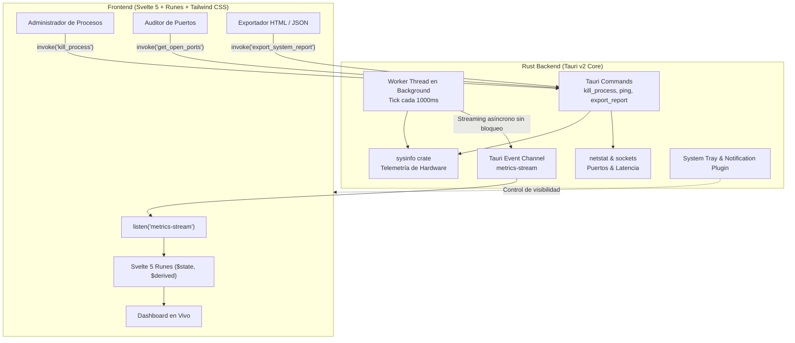

<div align="center">

# ⚡ SysPulse

### Monitor de Sistema y Diagnóstico Local de Alto Rendimiento

[](https://tauri.app/)
[](https://www.rust-lang.org/)
[](https://svelte.dev/)
[](https://tailwindcss.com/)
[]()
[](LICENSE)

<br/>

**SysPulse** es una herramienta de escritorio ligera, ultra-eficiente y moderna para monitorear y auditar hardware y procesos en tiempo real. Construida con **Tauri v2** y **Rust** en el backend para una integración nativa profunda con el sistema operativo, combinada con una interfaz reactiva oscura en **Svelte 5** (Runes).

[Descargar Instalador (.exe / .msi) 🚀](https://github.com/Furia04/syspulse/releases/latest) • [Ver Arquitectura](#-arquitectura-ipc-h%C3%ADbrida) • [Comparativa vs Electron](#-por-qu%C3%A9-tauri--svelte-5-vs-electron)

</div>

---

## ⚡ ¿Por qué Tauri + Svelte 5? vs Electron

La mayoría de las herramientas de escritorio modernas (Slack, Discord, VS Code) empaquetan una copia completa de Chromium y Node.js, devorando cientos de megabytes de memoria solo para arrancar. **SysPulse** demuestra cómo construir software de escritorio nativo con consumo mínimo de recursos:

| Métrica / Característica | SysPulse (Tauri v2 + Rust + Svelte 5) | Alternativa Basada en Electron |
| :--- | :---: | :---: |
| **Consumo de Memoria RAM (Idle)** | **~25 - 35 MB** | ~180 - 350 MB |
| **Tamaño del Paquete Web (Frontend)** | **~113 KB** (Vite + Svelte Runes) | ~15 - 50 MB (Node modules / Chromium runtime) |
| **Instalador Final (.exe / .msi)** | **~28 MB** (con WebView2 integrado) | ~80 - 150 MB |
| **Tiempo de Arranque en Frío** | **< 300 ms** | 1.5 - 3.5 segundos |
| **Acceso a Hardware & Sistema** | **Nativo y Seguro en Rust** (`sysinfo`) | Vía Node.js bridge con sobrecarga de IPC |
| **Superficie de Seguridad** | Binario compilado con capacidades mínimas | Node.js completo expuesto en proceso local |

---

## 🖥️ Interfaz y Capacidades

```
┌──────────────────────────────────────────────────────────────────────────────────────────────┐
│  ⚡ SysPulse v0.1.0        [ Dashboard ]  [ Procesos ]  [ Red & Puertos ]  [ Diagnósticos ]  _ □ ✕ │
├──────────────────────────────────────────────────────────────────────────────────────────────┤
│  Host: PC-DEV  •  SO: Windows 11 (x86_64)  •  Uptime: 2d 4h 12m  •  Estado: Óptimo           │
├───────────────────────┬───────────────────────┬───────────────────────┬──────────────────────┤
│ CPU TOTAL: 14.2%      │ MEMORIA RAM: 48.5%    │ RED EN VIVO           │ ALMACENAMIENTO       │
│ ~~~~~/\/\/\/\_/\_     │ ~~~--~-~/\/\/\_       │ ↓ 1.4 MB/s  ↑ 220 KB/s│ C:\  42% (280 GB lib)│
│ Intel Core i7 (16 C.) │ 7.8 GB / 16.0 GB      │ Total: ↓4.2GB ↑890MB  │ D:\  65% (650 GB lib)│
├───────────────────────┴───────────────────────┴───────────────────────┴──────────────────────┤
│ 📊 CARGA INDIVIDUAL POR NÚCLEO (16 Hilos Lógicos)                                            │
│ [C#0: 12%] [C#1: 18%] [C#2: 4%] [C#3: 25%] [C#4: 8%] [C#5: 15%] [C#6: 3%] [C#7: 10%] ...    │
└──────────────────────────────────────────────────────────────────────────────────────────────┘
```

### 1. Dashboard de Hardware en Tiempo Real
- Telemetría continua cada 1 segundo con micrográficos tipo **Sparkline SVG** de los últimos 60 segundos.
- Desglose reactivo de uso y frecuencia por cada núcleo físico y lógico de la CPU.
- Monitoreo de memoria RAM y Swap con alertas visuales de picos de carga.
- Estado de particiones de disco, espacio disponible y sistema de archivos.

### 2. Administrador de Procesos
- Inspección interactiva de todos los procesos activos en el sistema operativo.
- Filtrado y búsqueda instantánea por nombre de ejecutable o PID.
- Ordenamiento dinámico por consumo de CPU, memoria RAM o identificador.
- Finalización forzada (**Kill Process**) protegida por modal de confirmación.

### 3. Auditoría de Red y Puertos Locales
- Velocímetro de descarga y subida en tiempo real con contadores acumulativos de sesión.
- Escaneo de sockets TCP locales en estado `LISTENING` vinculados automáticamente a su PID y proceso responsable.

### 4. Diagnóstico de Latencia y Exportación de Informes
- Test de ping RTT en milisegundos hacia servidores clave (Cloudflare `1.1.1.1`, Google `8.8.8.8`, Quad9, etc.) o hosts personalizados.
- **Generador de Informes en 1-Clic**: Exporta instantáneamente una auditoría completa del sistema en **HTML interactivo autónomo** (con tema oscuro embebido para abrir en cualquier navegador) y **JSON estructurado**.

### 5. Integración con el Sistema Operativo
- Ventana personalizada sin marcos (*frameless*) con controles integrados y drag region nativa.
- Soporte para **System Tray** (minimizar al área de notificaciones con menú contextual).
- **Notificaciones de escritorio nativas** cuando el uso de CPU o memoria excede el 90%.

---

## 🏗️ Arquitectura: IPC Híbrida

SysPulse implementa un modelo de comunicación inter-procesos (*IPC*) híbrido y eficiente entre el motor de Rust y la vista en Svelte 5:



---

## 📦 Instalación y Descargas

Podes descargar directamente la última versión compilada para tu sistema desde la sección de [**Releases**](https://github.com/Furia04/syspulse/releases):

- **Windows**: `syspulse_0.1.0_x64-setup.exe` (Instalador NSIS) o `syspulse_0.1.0_x64_en-US.msi`.

---

## 🛠️ Desarrollo Local

### Requisitos
- [Node.js](https://nodejs.org/) (versión 18 o superior)
- [Rust](https://www.rust-lang.org/) (versión 1.85+)

### Pasos
```powershell
# 1. Clonar el repositorio
git clone https://github.com/Furia04/syspulse.git
cd syspulse

# 2. Instalar dependencias del frontend
npm install

# 3. Iniciar entorno de desarrollo
npm run tauri dev

# 4. Ejecutar pruebas unitarias de Rust
cd src-tauri
cargo test
```

---

## 📄 Licencia

Este proyecto se distribuye bajo la licencia **MIT**. Consulte el archivo [LICENSE](LICENSE) para más detalles.
